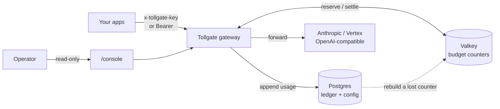
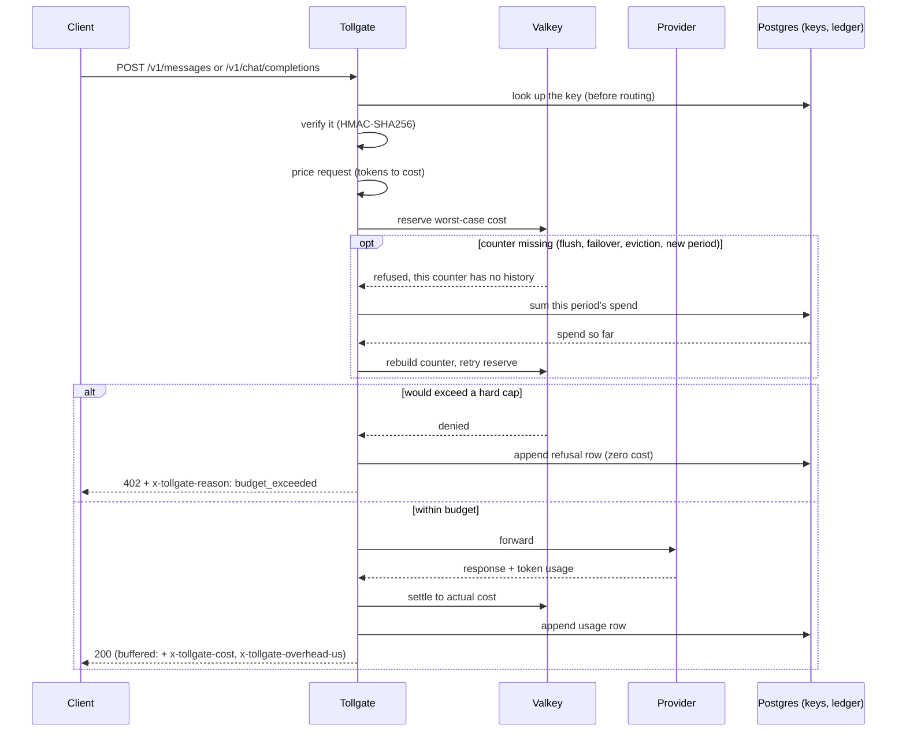

# Tollgate

<picture>
  <source media="(prefers-color-scheme: dark)" srcset="assets/brand/tollgate-logo-dark.svg">
  
</picture>

[](https://github.com/sakura-sky/tollgate/actions/workflows/ci.yml)
[](./LICENSE)
[](https://reuse.software/)

Tollgate is an open-source AI gateway and spend-control proxy. It sits between your applications and their LLM providers (Anthropic, Google Vertex, and any OpenAI-compatible upstream today), prices each request by token, reserves budget before the call, and **refuses any request whose worst-case cost would exceed a budget, before it reaches the model**. Spend is written to a durable, append-only ledger, and a read-only web console shows live budgets, spend, and the gateway's own added latency.

The reservation is the enforcement point, and a request settles to its exact reported cost afterwards. Settlement can land above the reservation in a handful of specific cases, all listed under [Limitations](#limitations); the design's one absolute is that it errs upward, never down.

It draws on the proxy and cost-control patterns popularised by [LiteLLM](https://github.com/BerriAI/litellm), implemented in Rust under MIT.

## Status

Beta, pre-1.0. The budget-enforcement core, provider adapters, web console, config hot-reload, and ledger retention are implemented and tested. The money path uses integer micros throughout with no floating point, reserves before forwarding and settles afterwards, and enforces through atomic Valkey scripts rebuilt from a Postgres ledger. Interfaces and schema may still change before 1.0. Read [Limitations](#limitations) before deploying it: the list is long on purpose, and several entries would change a deployment decision.

See [`CHANGELOG.md`](./CHANGELOG.md) for what each release changed.

## How it works



Each request is authenticated, priced by token, and checked against every budget that applies to it (its key, the provider, the model, and the global backstop) before it is forwarded. The worst-case cost is reserved up front; after the provider responds, the reservation is settled to the exact cost. If any hard cap would be exceeded, the request is refused with `402 Payment Required` before it reaches the provider.



## Use cases

- **Cap AI spend per team, customer, or key** with a real hard stop, not just an after-the-fact alert.
- **A global monthly ceiling** as a backstop across every key in a deployment.
- **One choke point** in front of multiple LLM providers, with an append-only spend ledger.
- **Give finance a live, currency-agnostic view** of token spend by model, key, and provider.
- **Show, don't claim, low overhead**: the console reports Tollgate's own added latency per request, as a median and a p95, so the figure is measured in your deployment rather than asserted here.

See [`docs/ARCHITECTURE.md`](./docs/ARCHITECTURE.md) for the components, data model, and enforcement invariants in detail.

## Demo (zero infrastructure)

No Postgres, Redis, or cloud credentials required. Boot an in-memory Tollgate
with a built-in mock LLM provider:

```bash
cargo run -- demo
```

It prints a demo API key and two budgets (a small per-key cap and a global
backstop), then proxies `/v1/mock/...` to the mock. Send requests and watch the
per-key budget meter by token cost and **hard-stop before overspend**:

```bash
curl -s localhost:8080/v1/mock/generate \
  -H "x-tollgate-key: <printed-key>" \
  -H 'content-type: application/json' \
  -d '{"model":"demo","prompt":"hello","max_output_tokens":1000}'
```

The first few requests return `200` with a cost breakdown; once the budget is
exhausted the gateway returns `402` **before the request reaches the provider**.
Inspect spend with the console endpoints (which require the key):
`curl -s -H "x-tollgate-key: <key>" localhost:8080/console/budgets` and
`/console/usage`. The demo binds to loopback by default, because `/console`
hands out the demo key. Inside a container loopback is unreachable from the
host, so `TOLLGATE_DEMO_BIND_ALL=1` makes it honour the IP in
`TOLLGATE_HTTP__BIND` instead and prints a warning banner; publish that
container's port on `127.0.0.1` only. `TOLLGATE_HTTP__BIND` defaults to
`0.0.0.0:8080`, so outside a container leave the flag unset: on its own it
listens on every interface. Or run the whole narrated sequence at once:

```bash
./scripts/demo.sh
```

That script binds port 8088 rather than the 8080 `cargo run -- demo` uses, so it
can run beside a gateway already holding 8080. Without cargo (or with
`USE_DOCKER=1`) it builds the image and runs the demo in Docker, published on
`127.0.0.1:8088`.

### Pointing Google ADK at Tollgate

Agent Development Kit agents reach Tollgate through its OpenAI-compatible
endpoint, so no ADK code changes and no Tollgate-specific SDK are involved: you
change a base URL and an API key, and the agent's spend starts being metered and
capped.

Enable the OpenAI-compatible route on the gateway, fronting Vertex:

```bash
TOLLGATE_PROVIDERS__OPENAI__ENABLED=true
TOLLGATE_PROVIDERS__OPENAI__UPSTREAM=vertex
TOLLGATE_PROVIDERS__VERTEX__PROJECT=my-project
TOLLGATE_PROVIDERS__VERTEX__LOCATION=us-central1
```

`TOLLGATE_PROVIDERS__VERTEX__LOCATION=global` uses Vertex's global endpoint,
which some newer Gemini models are served from. Google does not let you control
or know which region a global request is processed in, and not every model or
feature is available there. Google documents the `us` and `eu` multi-region
locations as keeping ML processing within the US or the EU respectively; see
Google's data-residency page for what that covers. Price each model at Google's
rate for the location you set. Tollgate uses one location for all Vertex
traffic.

Issue the agent its own key, and give that key its own budget, which is the
point of doing this at all:

```bash
tollgate admin key issue --label my-agent
tollgate admin budget set --scope api_key:<id> --period monthly --limit 50
```

Then in the agent, use ADK's `LiteLlm` model wrapper, which speaks the OpenAI
protocol:

```python
from google.adk.agents import LlmAgent
from google.adk.models.lite_llm import LiteLlm

agent = LlmAgent(
    model=LiteLlm(
        model="openai/gemini-2.5-flash",
        api_base="https://tollgate.internal/v1",
        api_key="tgk_...",           # the Tollgate key, not a provider key
    ),
    name="my_agent",
)
```

As written, this example is refused: `gemini-2.5-flash` is not built in, and
every `gemini-` model on the Vertex routes needs a `[[providers.models]]` row
stating its thinking behaviour (see
[`docs/OPERATIONS.md`](./docs/OPERATIONS.md#request-rules-media-sources-gemini-thinking-service-tier)),
so add that row, or use `openai/gemini-3.8-flash`, which is built in.

Three things to get right, each of which fails in a way that is not obvious:

- **`api_base` ends at `/v1`.** Tollgate serves `/v1/chat/completions`, and the
  OpenAI client appends `/chat/completions` itself. Include it and the request
  goes to `/v1/chat/completions/chat/completions`, which is a 404.
- **The `openai/` prefix on the model is LiteLLM's routing hint**, telling it to
  speak the OpenAI protocol. It is stripped before the request, so Tollgate sees
  `gemini-2.5-flash`. With `UPSTREAM=vertex` a bare id is forwarded as
  `google/gemini-2.5-flash`, and it is priced, budgeted and recorded under that
  id too, so `google/gemini-2.5-flash` under provider `openai` is the name you
  must price (`admin price set --provider openai --model google/gemini-2.5-flash`)
  and the one a `model:` budget names. A price row for the bare id matches no
  request, and the gateway logs a warning naming it.
- **Price the model first.** An unpriced model is refused with `400` and
  `x-tollgate-reason: unpriced`, deliberately, because a request Tollgate cannot
  cost is one it will not forward.

Set `ADK_...` or provider credentials on the agent and they are ignored: the
agent authenticates to Tollgate, and Tollgate holds the provider credential. That
separation is the reason an agent's key can be revoked or capped without touching
the provider account.

Streaming works, with one restriction: a streaming request under
`TOLLGATE_PROVIDERS__ADMISSION=exact` is refused with `501` on this route (to an
authenticated caller; without a valid key every request gets `401` first, or
`503` if the key store cannot answer). Run
`fast` admission if your agents stream, which is the default.

### Console (read-only web UI)

The demo also serves a self-contained web console. After `cargo run -- demo`
starts, open the printed URL:

```
http://localhost:8080/console
```

It shows the per-key and global budget meters, live spend, the tokens-to-cost
breakdown, and recent usage, refreshing every second. Click **Send test request**
(or **Auto-send**) and watch the per-key meter climb green to amber to red and
the hard-stop banner appear when the budget is exhausted, while the global
backstop barely moves. In the demo the console is seeded with the demo key so it
connects on load; when the gateway serves it in production the viewer supplies
their own key. The console is deliberately observe-only: it reads the same
key-authenticated JSON endpoints you would call with curl.

## Quick start (local)

Requires Rust 1.88, Docker, and Docker Compose.

```bash
# 1. Bring up Postgres + Valkey
docker compose -f compose/docker-compose.yaml up -d

# 2. Configure. Edit .env and set TOLLGATE_SECURITY__API_KEY_PEPPER to a real
#    secret of at least 16 bytes: the placeholder shipped in .env.example is
#    refused at boot, so leaving it makes step 4 fail.
cp .env.example .env
set -a; source .env; set +a

# 3. Apply migrations
cargo run --bin tollgate -- admin migrate

# 4. Run the gateway
cargo run --bin tollgate -- serve

# 5. Smoke test
curl -s http://localhost:8080/healthz | jq
curl -s http://localhost:8080/readyz  | jq
```

To run the gateway in Docker instead of steps 3 and 4, after step 2:

```bash
docker compose -f compose/docker-compose.yaml --profile app up -d --build
```

The `tollgate` service sits behind the `app` profile, so step 1 still starts
only the dependencies. It reads `.env`, overrides the database and Valkey URLs to
the compose service names, publishes on `127.0.0.1:8080`, and sets
`TOLLGATE_DATABASE__AUTO_MIGRATE=true` so it boots on a fresh volume. That
setting is for local dev only: in production keep `admin migrate` an explicit
step.

## Monitoring

The gateway exposes standard operational endpoints for your SRE stack:

- `GET /healthz` - liveness ping
- `GET /readyz` - readiness
- `GET /metrics` - Prometheus text format: `tollgate_up`, `tollgate_requests_total` by decision (`allowed`, `estimated`, `rejected_budget`, `unpriced`, `error`, `unauthenticated`, `key_store_error`), `tollgate_cost_micros_total`, `tollgate_budget_limit_micros` labelled by scope, period and whether the cap is hard, and `tollgate_unmatchable_budgets`, the number of configured budgets that cannot match some or all of their requests: a key id that is not a UUID, a provider that is not enabled, a model with no current price, a model also priced under a second name with no budget at least as hard of its own, or an `openai` model budget with a bare id while `/v1/chat/completions` reaches Vertex. A Vertex budget while `/v1/chat/completions` also reaches Vertex is logged but not counted, since no budget can clear it. Alert on it being above zero; a budget staged on purpose for a disabled provider or an unpriced model keeps it raised until it can match. `unauthenticated` counts every request under `/v1` or `/console/` refused for its key, including unknown paths, wrong methods and `/v1/messages/` sub-paths. `key_store_error` counts requests refused with `503` because the key store could not answer; alert on it separately, since it means Postgres, not a caller. Counters are process-lifetime and reset on restart. A scrape reads process memory only and deliberately queries neither Postgres nor Valkey, so budget *spend* is not exported: those figures live in the two stores that fail during an incident, and an observability path that dies with the thing it observes is worse than one with a stated limit. Spend is on `/console/budgets`, which queries Postgres and says so. That describes `serve`. `tollgate demo` deliberately exposes a different set: it adds a `tollgate_budget_spent_micros` gauge (everything it knows is already in memory), omits the `estimated` and `key_store_error` decisions and the `tollgate_unmatchable_budgets` gauge, and labels `tollgate_budget_limit_micros` by scope only. Do not size a dashboard on what the demo shows.

Traces export via OTLP when `TOLLGATE_TELEMETRY__OTLP_ENDPOINT` is set. The endpoint must be `http://host:port` or `unix:///path`: export is plaintext gRPC with no TLS compiled in, so send traces to a local OpenTelemetry Collector and let it use TLS to your backend. Any other value is refused at startup, and an empty value disables export.

## Routes

| Route | Method | Auth accepted |
| --- | --- | --- |
| `/v1/messages` | POST | `x-tollgate-key`, `Authorization: Bearer`, or `x-api-key` |
| `/v1/messages/{path}` | POST | as `/v1/messages`; answers `404` (not metered) |
| `/v1/chat/completions` | POST | `x-tollgate-key` or `Authorization: Bearer` |
| `/v1/{provider}/{path}` | POST | `x-tollgate-key` or `Authorization: Bearer` |
| `/console` | GET | none (the page itself; the viewer supplies a key to the endpoints below) |
| `/console/budgets`, `/console/usage` | GET | `x-tollgate-key` or `Authorization: Bearer` |
| `/healthz`, `/readyz`, `/metrics` | GET | none |

Every authenticated route accepts the key either as `x-tollgate-key` or as
`Authorization: Bearer`. `x-api-key` is read on `/v1/messages` and the paths
under it only, so the Anthropic SDK works against it unchanged. Other sub-paths
of `/v1/messages/`, such as `count_tokens` and `batches`, return 404 to an
authenticated caller: they are not metered, and serving them unmetered would
put spend outside the ledger.

When more than one key header is present, `x-tollgate-key` wins, then
`x-api-key` (on `/v1/messages` paths only), then `Authorization: Bearer`. An
`x-tollgate-key` header that is present but empty, blank or not readable as text
is skipped in favour of `Authorization: Bearer`, but it still stops `x-api-key`
from being read.

Authentication comes first. A request to `/v1`, to any path under `/v1/`, or to
any path under `/console/` without a valid key gets `401` before anything else
runs, including on unknown paths and with the wrong method. The response depends
only on which family the path belongs to (Anthropic, OpenAI, the enveloped
`/v1/{provider}` routes, or the console), never on which providers are enabled,
the admission mode, prices, budgets, the method or the body. The one other answer
is `503` with `x-tollgate-reason: backend_error` when the key store cannot answer
within `TOLLGATE_DATABASE__ACQUIRE_TIMEOUT` plus 250 ms. Only the exact key shape
Tollgate issues (`tgk_`, 16 lowercase hex characters, `_`, 48 lowercase hex
characters) is looked up; anything else is refused without touching Postgres.
[`SECURITY.md`](./SECURITY.md) gives the limits of this: a HEAD response carries
no body on the wire, and how long a `503` takes reflects that timeout and how
busy key lookups are.

`/console` is unauthenticated because it holds no data. It is a static asset that
fetches everything from the two JSON endpoints, so serving it to an anonymous
viewer discloses nothing; the key is checked on the endpoints that hold the
data.

A buffered success carries the request's settled cost. On `/v1/messages` and
`/v1/chat/completions` it is the `x-tollgate-cost` response header, so a client
reads it without touching the body it was going to parse as the provider's. The
catch-all `/v1/{provider}/{path}` route wraps the upstream body anyway, so the
figure goes inside its `tollgate` envelope instead. Streams carry neither: the
cost is not known when the headers are sent. Every response on `/v1` and
`/console/*` also carries `x-tollgate-request-id` (see below).

Every refusal Tollgate itself generates on `/v1` and `/console/*` carries
`x-tollgate-reason`, and it means the same thing on every route: `budget_exceeded` on a `402` (a hard cap would have been breached),
`unpriced` on a `400` (no price is configured for that provider and model, so
Tollgate refuses rather than forwarding something it cannot cost), then
`unauthenticated`, `bad_request`, `backend_error`, `upstream_error`,
`upstream_rate_limited` on a `429` (the provider is rate limiting this
deployment), `forbidden_source` on a `403` (the request names media the
provider would fetch on the operator's behalf from a source the operator
has not allowed, such as a `gs://` bucket off the allowlist), and `unsupported`
on the `501` for streaming under `exact` admission. Alert on the header. On `/console/*` that includes the `404`, `405` and request-timeout `503`
the HTTP framework generates (`bad_request`, `bad_request` and `backend_error`).
On `/v1`, the framework's own answers to an authenticated caller (`404` for a
path no route serves, such as `/v1/models`; `405` for a wrong method; `413` for
a body over 2 MiB; `400` for a path or body that does not decode) carry no
header. A POST to any other path with two or more segments under `/v1/` reaches
the `/v1/{provider}/{path}` route, which refuses an unknown provider itself:
`400` with `x-tollgate-reason: unpriced`.

`backend_error` means Tollgate's own dependencies, Valkey or Postgres (a key
store that cannot answer is also counted as `key_store_error`), or a streaming
request for a provider this deployment has not enabled. The `501` and the
not-enabled `503` are returned only to an authenticated caller.
`upstream_error` means the provider, including the case where the provider
rejects Tollgate's own credential. The pre-flight token count that `exact`
admission makes before forwarding is classified the same way as the request
itself (the table below): a count the provider could not answer at all is
`upstream_error`.

When the provider refuses a request, the client gets a classified refusal,
never the provider's response:

| Provider status | Client gets | Reason |
| --- | --- | --- |
| `400`, `413`, `422` (the request body is at fault) | the same status | `bad_request` |
| `429` | `429`, with `Retry-After` when the provider sent a whole number of seconds, clamped to 1 to 60 | `upstream_rate_limited` |
| `401`, `403`, `404` and every other non-2xx | `502` | `upstream_error` |
| a `200` that is not an event stream on a stream route, or a buffered `200` whose body is an error | `502` | `upstream_error` |

A `401`, `403` or `404` from the provider describes Tollgate's own credential or
configuration, not the caller's, so it is never passed on as such. The
refusal's body is fixed text in the route's format. The provider's message and
headers are not passed on, because they can name the cloud project, region and
resource path. The gateway's log line for the response's
`x-tollgate-request-id` carries the provider's error type, error code and own
request id; the first 2 KiB of the provider's body is logged only while the
operator has switched it on (see [`docs/OPERATIONS.md`](./docs/OPERATIONS.md)).
This covers every response the provider sends with a non-2xx status, buffered
or streaming, and a `200` whose body is really an error. Inside a stream that
started with `200`, Tollgate forwards only events it can classify as safe: no
data, `[DONE]` (on `/v1/chat/completions`), or one strictly parsed JSON object
with no top-level `error` other than `null` (and, on `/v1/messages`, no
`"type": "error"`). An error event, or anything it
cannot classify, ends the client's stream with one fixed error event in the
route's format (on `/v1/messages`,
Anthropic's `overloaded_error`, `rate_limit_error` and `timeout_error` keep
their type; anything else is `api_error`), and the client gets nothing more.
Tollgate still reads and meters the provider's stream to its end (within the
idle and maximum-duration limits), even if the client then disconnects, so what
is charged does not change. The `stream settled` log line's `client_ended`
field says why, when the client's stream was ended this way. A `200` that is not an event stream at all is a `502`
before the stream starts, charged its reservation, because the provider may
have billed it. Only protocol-level error events are recognised: text in any
other field of a safe event (the generated output, or an error a provider
nests inside a choice) is relayed as the provider sent it.

Every response on `/v1` and `/console/*` carries `x-tollgate-request-id`, a
random id Tollgate generates for that request (a client-supplied value is never
used). Quote it when reporting a failure: it is on the log lines written while
an authenticated request is handled (including the stream relay and
settlement), and on the log line for a provider refusal. The demo does not set
it, and nor does the `500` for a panic in the authentication gate itself.

The response BODY is shaped for whichever client the route serves, so on
`/v1/messages` it is an Anthropic error envelope and its `error.type` uses
Anthropic's vocabulary, which the SDK maps to an exception class. A budget
refusal is therefore `permission_error` in the body and `budget_exceeded` in the
header. Those are the same event described to two different audiences.

## Managing keys and budgets

Keys and budgets are managed with the `tollgate admin` CLI against your Postgres.
From a source checkout the binary is not on your `PATH`, so either prefix with
`cargo run --` or install it once with `cargo install --path .`. The admin
commands need Postgres running, `TOLLGATE_DATABASE__URL` and a fixed
`TOLLGATE_SECURITY__API_KEY_PEPPER` (at least 16 bytes) set, and migrations
applied:

```bash
docker compose -f compose/docker-compose.yaml up -d
cp .env.example .env            # set TOLLGATE_SECURITY__API_KEY_PEPPER to a real secret
set -a; source .env; set +a
cargo run -- admin migrate
```

Issue a key (the plaintext is shown once and never stored; the command also
prints the key's id, which you need for a per-key budget):

```bash
cargo run -- admin key issue --label "team-alpha"
```

Set a global backstop and a per-key cap (amounts are in your configured currency;
budgets hard-stop by default):

```bash
cargo run -- admin budget set --scope global --period monthly --limit 500
cargo run -- admin budget set --scope api_key:<id> --period monthly --limit 25
```

Scopes are `global`, `api_key:<uuid>`, `provider:<name>`, or
`model:<provider:model>`; periods are `daily`, `weekly`, or `monthly`.
`admin budget set` refuses a scope that could never match a request: a key id
that is not a UUID (any UUID form is accepted and stored in canonical form), a
provider other than `anthropic`, `mock`, `openai` or `vertex`, or a model with no
current price. Pass `--allow-unpriced` to set a model's cap before its price, so
the cap applies once the model is priced and the gateway has reloaded. The CLI
checks the provider name against the four this build knows, not against what a
deployment has enabled, so a budget for a provider that is switched off is
accepted and then reported by the warning and the gauge below. Scopes follow the route a request
uses: `/v1/chat/completions` is `openai` whatever its upstream, so
`provider:vertex` does not cover it, and `/v1/{provider}/...` uses the path
segment. A model priced under two names (for example `x` and `org/x` on a
custom upstream) needs a budget under each, and each budget enforces its own
limit, so split the intended cap between them. With `upstream = vertex`,
`/v1/chat/completions` prices and scopes a bare id as its `google/` id, so
`gemini-x` and `google/gemini-x` are one model there: budget
`model:openai:google/gemini-x`, since `model:openai:gemini-x` matches nothing. At startup
and whenever the set changes on reload, the gateway logs a warning for every
budget that cannot match some or all of its requests, and
`tollgate_unmatchable_budgets` counts those a budget change could fix. Revoke a
key with `admin key revoke --key <key-or-prefix>`. Set model prices (per 1,000,000
tokens) so spend can be costed:

```bash
cargo run -- admin price set --provider anthropic --model claude-sonnet-4-5 \
  --input-per-1m 3 --output-per-1m 15 \
  --cache-read-per-1m 0.30 --cache-write-per-1m 3.75
```

Those figures are illustrative, not a price list. Check them against the
provider's current pricing page before you rely on them: Tollgate ships no
prices and cannot tell you when one changes.

Set the cache rates. A prompt-cache class you leave unpriced is not free: it
falls back to a conservative multiple of the input rate, which over-charges a
cache read by roughly 10x. The model name must match what your client sends,
exactly and case-sensitively, or the request is refused as `unpriced`.

On a re-price, cache rates and the long-context tier CARRY FORWARD unless you
set or clear them, so bumping a base rate does not silently drop them. Clear one
with `--clear-cache-read`, `--clear-cache-write`, or `--clear-long-context`.
`admin price set` prints the tier the model will actually run with; fields it
inherits from the deployment default are marked, and they resolve against the
environment the CLI runs in, so run it with the same `TOLLGATE_BILLING__*`
values as `tollgate serve`.

There is no `admin list` or `admin delete` in this release. To see or remove
budgets and prices, query Postgres directly: `SELECT * FROM budgets;`,
`SELECT * FROM model_prices WHERE effective_to IS NULL;`.

`key issue`, `budget set` and `price set` each append a row to `audit_log`, as
does `key revoke` when it actually revokes something, in the same
transaction as the change, so a failed audit insert rolls the change back rather
than leaving it untraced. Read it with `SELECT occurred_at, principal, action,
resource, metadata FROM audit_log ORDER BY occurred_at DESC;`. The `principal` is
`cli:<user>@<host>`, self-asserted rather than authenticated: see
[`SECURITY.md`](./SECURITY.md). No secret is recorded.

In a running deployment the gateway also serves the read-only web console at
`/console`, along with the key-authenticated JSON it reads: `GET /console/budgets`
(current-period spend and limit per budget) and `GET /console/usage` (the 100
most recent ledger rows, oldest first). Open `/console`, paste an API key, and you get the live budget
meters and usage that the demo shows. These endpoints are observe-only; there are
no write endpoints in the open-source core.

Authorization is deliberately flat: any valid key may view the deployment's
budgets and usage, because Tollgate is single-tenant per deployment (one trust
boundary). Per-tenant scoping, roles, and SSO on these views are planned for the
Tollgate Enterprise edition (see below), not the open-source core.

Every proxied request records the gateway's own added latency. The console shows
the median and p95, and each buffered response carries an
`x-tollgate-overhead-us` header. Streaming responses carry no cost or overhead
header, because neither figure is known when the headers are sent; read them
from `/console/usage` instead.
The figure covers the admission path only: authentication, pricing, and the
reservation. It excludes the upstream provider call, and under `exact` admission
it also excludes the pre-flight token count, which is a full provider round trip
that `exact` adds to every request. So the header is what Tollgate costs you in
`fast` mode, and an understatement of what `exact` costs you.

Budget and price changes apply within the reload interval
(`TOLLGATE_RELOAD__INTERVAL`, default 15s) without restarting the gateway; set it
to `0s` to read config only at startup. A changed limit applies to the existing
spend counter; a brand-new budget's counter, if it has none yet, is seeded from
the spend already recorded this period when it is first picked up. Each load also re-checks every
budget against the enabled providers and current prices, logs any that cannot
match (once per change) and updates `tollgate_unmatchable_budgets`; with `0s`
that check runs only at startup.

### Admission modes and the hard-stop guarantee

Before forwarding, Tollgate reserves the worst-case cost of a request. Output is
capped by the request's `max_tokens` / `maxOutputTokens`, so the output side is
always bounded. Input tokens are counted one of two ways, set by
`TOLLGATE_PROVIDERS__ADMISSION`:

- `fast` (default): estimate input tokens from the request body. No extra call,
  lowest latency. The estimator counts roughly four ASCII bytes to the token,
  which is about right for prose and too generous for code, JSON, and numeric
  text, where real tokenisation runs closer to two or three characters per
  token. So a reservation can be low by up to roughly the input leg's own size,
  and the request settles above it. The overshoot is bounded by the input-leg
  error times the input rate, per request in flight, not once per cap crossing.
  Every non-ASCII byte is counted as a whole token, so dense multibyte text
  (CJK, emoji) is deliberately over-estimated rather than under-reserved.
- `exact`: make a pre-flight token-count call to the provider. One extra call per
  request. The input leg is then reserved at the provider's own count, so
  tokenisation drift is eliminated.

Either way the request settles to the provider's reported usage, or to its
reservation when that usage cannot be trusted, and the ledger row says which.
Choose `exact` when you need the input side of the cap to be strict to the token.

`exact` removes tokenisation drift, not every way a settlement can exceed a
reservation. Server-injected tool-use prompt tokens, long-context re-rating, and
untrusted-usage settlements can all still settle above the reservation. Each is listed under
[Limitations](#limitations). None of them can settle BELOW the true cost, which
is the property the design actually guarantees.

## Limitations

Known limitations in this release, stated up front:

- **A client never sees the provider's own error message.** A refused request gets a classified status, a reason and a fixed message, so a developer whose request a provider rejects is told it was rejected and given a request id, not why. The gateway's log has the provider's error type and code under that id, and the first 2 KiB of the provider's body only while the operator has switched it on. This is deliberate: provider messages can name the deployment's cloud project, region and resource paths.
- **Streaming under `exact` admission is refused on the OpenAI path.** A streaming request to `/v1/chat/completions` with `TOLLGATE_PROVIDERS__ADMISSION=exact` returns `501` to an authenticated caller. The native Anthropic path at `/v1/messages` does support the combination, because `count_tokens` gives it a real pre-flight count for the prompt.
- **Streaming is supported on `/v1/chat/completions` and `/v1/messages` only.** The native Vertex adapter still allows only `:generateContent`, because usage cannot be metered from a partial `streamGenerateContent` response.
- **A stream that does not end cleanly is charged its full reservation**, which over-charges. "Cleanly" means the provider said it finished, not merely that the connection closed, because a proxy can close a connection cleanly mid-generation. On `/v1/messages` that is Anthropic's `message_stop`: Anthropic reports a small placeholder `output_tokens` in `message_start` and can deliver an error event on an otherwise-healthy 200 stream, so trusting the connection would under-charge a failed stream by its entire output leg. On `/v1/chat/completions` a stream is charged its measured usage when the upstream sent a non-empty `finish_reason` with no output after it, a usage report in or after that chunk, and `data: [DONE]`. A client that stops reading at the end of an answer, before `[DONE]`, is still measured: once the finish has arrived, Tollgate keeps reading the upstream for up to 10 seconds after it notices the client has stopped, without forwarding anything, to receive the usage and `[DONE]`. On Cloud Run with CPU allocated only during requests (`cpu_idle = true` in the shipped Terraform), that work may run with throttled CPU once the client has gone, so a drain can expire and charge the reservation. Two consequences for a custom OpenAI-compatible upstream: one that never sends a `finish_reason` or `[DONE]` is charged its reservation on every stream, and usage is assumed to be cumulative, so one that reports per-chunk deltas would be under-counted, or charged its reservation where a delta is smaller than the one before. Each stream the relay settles logs a `stream settled` line giving how it ended and what was seen, at `debug` when it was measured, ended at the provider's end marker and was not drained, and at `info` otherwise. Streams are cut after 60 seconds with no bytes, or 15 minutes in total, and charged their reservation. `/console/usage` splits `measured_cost` from `estimated_cost` over the rows it returns, so this is visible rather than silent. One exception: on `/v1/messages`, when Anthropic reports an error before generating anything (`overloaded_error` is the common one), only the reserved prompt leg is charged, because nothing was generated and SDK retries would otherwise multiply a full worst-case reservation through an overload window.
- **Claude is reached at `/v1/messages`, not `/v1/chat/completions`.** Tollgate does not translate between provider protocols. Point your client's native Anthropic support at it; the Anthropic SDK, LiteLLM and the ADK all speak it. Do **not** configure Anthropic's own OpenAI-compatible endpoint as a custom upstream: it reports no prompt-cache tokens at all, so every cached Claude request would be silently under-counted. Tollgate refuses the obvious form of this at boot, but a CNAME or proxy in front of it cannot be detected.
- **`anthropic-beta` headers are refused unless known to be billing-neutral**, and the service tier is constrained. Some betas and tiers change the per-token rate in ways a single configured price cannot express. On `/v1/messages` the allowlisted betas a client sends are forwarded on the Messages call (every header instance, comma-split, deduplicated), but not on the `exact` pre-flight count; the legacy `/v1/anthropic/messages` route does not check betas and forwards none. The outbound `service_tier` is pinned to `standard_only`. On `/v1/chat/completions` a `service_tier` that is present and not exactly the string `"default"` is refused, including an explicit `auto`, which lets the provider pick a premium tier. An omitted tier means `auto` on OpenAI's own API, so `TOLLGATE_PROVIDERS__OPENAI__PIN_SERVICE_TIER` (on by default when a custom upstream's host is `api.openai.com`, off for any other host, since other servers may reject the field) sends `service_tier: "default"` on every request. On Vertex the field is dropped from the outbound body.
- **`max_tokens` defaults to 4096 on the OpenAI path** when a client omits it, or sends it as null or zero, which truncates otherwise-longer answers. There is no response header announcing this, so a client that relies on the upstream's own default will see answers cut short with no signal from Tollgate. The outbound body is normalised to a single `max_tokens` equal to the reserved cap, so what was reserved is what the provider enforces. The native Anthropic path requires `max_tokens`, so no default is applied there.
- **Vertex's OpenAI-compatible endpoint is a Preview surface** under Google's Pre-GA terms, not GA. It is the only *streaming* route to Gemini: the native Vertex adapter serves `:generateContent` only.
- **Prompt-cache classes are priced separately, but only if you price them.** Set them with `admin price set --cache-read-per-1m --cache-write-per-1m`. A class left unpriced is NOT free: it falls back to a conservative multiple of the model's input rate (1x for reads, 2x for writes), because defaulting to zero would silently under-charge every cached request. That fallback deliberately over-charges reads by roughly 10x, since a real cache read costs about a tenth of the input rate, so a 200k-token cached prompt on a $3/1M model bills at roughly $0.06 upstream and records at roughly $0.60 until you set a real rate. The gateway logs a warning naming every model still on fallback rates.
- **Provider context-cache creation and storage are invisible to any proxy.** Google's explicit context caching bills cache *creation* and per-token-hour *storage* against the cache resource, outside the proxied request path, so neither appears in any request's usage block and Tollgate cannot meter or budget them. Requests that *reference* a cache by name are refused on both Vertex routes, because the cache cannot be sized before forwarding; cached tokens from implicit caching are metered in full, since Gemini reports them inside `promptTokenCount`. An agent holding direct `cachedContents` permission can therefore move the creation and storage portion of its spend outside its budget; restrict that permission if the budget needs to be binding.
- **Long-context tiering is opt-in per model, and under-charges until you opt in.** Several current models bill the whole request at a higher rate above roughly 200k prompt tokens, typically 2x on input and 1.5x on output. A price is one rate per class and cannot express that. Set a model's tier with `admin price set --long-context-threshold --long-context-input-permille --long-context-output-permille`, and it applies to the reservation as well as the settlement. Multiples are accepted only between 1000 and 10000 per-mille (1.0x to 10x); anything outside is refused at boot and by the database CHECK. The tier lives on the price row, so a gateway fronting one model that tiers and one that bills flat does not have to choose which to get wrong; each field falls back to the deployment default when the row leaves it null. Disable tiering for a single model with `--long-context-threshold 0`, which also drops any multiples that model was carrying; `--clear-long-context` instead returns it to the deployment default. A deployment-wide multiple above 1.0x against a threshold of `0` is refused at boot, because it re-rates nothing and suppresses the under-charge warning too, so it would look configured and do neither. It is **off until set**, because a given model may not tier at all: defaulting to an uplift would invent a charge on a flat-billed model and break the meaning of a rate, since one million tokens would stop costing the per-million rate. Until you set it, a prompt above the threshold is logged as a possible under-charge rather than silently re-rated. The reservation applies the tier slightly below the threshold so that small counting drift cannot flip a request into a multiple it never reserved, and on an upstream whose cache convention is unverified it sizes the prompt at double, because that is what the billing already assumes there. That guard is only as good as the count: under `fast` admission the reported size can still land far above the reservation and settle at the tier rate, the same overshoot the `exact` admission limitation describes, now multiplied by the tier.
- **Some charges are not modelled at all, and they under-charge.** Per-modality rates (audio input bills several times text on some models); provider server-side tool fees such as web search or code execution, billed per request rather than per token; and grounding fees. Requests that would incur the tool fees, non-text output modalities, audio, and Predicted Outputs are refused on `/v1/chat/completions` rather than mis-billed, and native Vertex `:generateContent` refuses every tool other than `functionDeclarations`. Native Vertex `:generateContent` requests carrying inline non-text parts are not detected, and would be billed at the text rate.
- **External media is refused on `/v1/messages` and `/v1/chat/completions` in BOTH admission modes.** Both adapters refuse a body referencing a file URI, a file id, an `image_url` or an `input_audio` part, unconditionally, so vision, PDF-by-URL, file-id and audio requests through those routes get a `400` whatever `TOLLGATE_PROVIDERS__ADMISSION` is set to. Switching to `exact` does not unlock them. On native Vertex `:generateContent`, in both modes, a `fileData` URI naming a `gs://` bucket off the allowlist or a Google storage host is a `403` and any other `https://` URI a `400`; a `gs://` URI in an allowlisted bucket is refused under `fast` admission and counted by the pre-flight under `exact`, because there the pre-flight count sizes it and the fast estimate cannot.
- **Native Vertex `fileData` URIs are limited to allowlisted `gs://` buckets, in both admission modes.** Google's docs require a `gs://` object to be public or in the project sending the request, so Vertex reads it on the operator's behalf (which Google identity does the read is unverified), and a key holder could otherwise make the model read any bucket the operator's project can see. A `gs://` URI is accepted only when its bucket (the text between `gs://` and the next `/`) exactly matches an entry in `providers.media.gcs_buckets`, which is empty by default; a URI containing `%`, `..` or `\`, an uppercase or empty bucket, and any scheme other than `gs://` and `https://` are refused. The refusal is a `403` with `x-tollgate-reason: forbidden_source` and fixed text that does not repeat the URI, and it happens before the `exact` pre-flight count, which would read the object too. `fileData` is checked wherever it appears, including `systemInstruction` and `functionResponse`.
- **Native Vertex requests are an allowlist.** The body is parsed with duplicate keys and out-of-range integers refused, and checked with Google's own objects read as camelCase (two spellings of one field in one object are refused). The client's bytes are then forwarded unchanged, key order included; Google's parser accepts both spellings (a live check showed a snake_case `generation_config.max_output_tokens` honoured), and since every ambiguous body was refused, that is the request that was checked. Client-owned maps (`functionCall.args`, `functionResponse.response`, schemas, `labels`) are left as sent. Top-level fields: `contents`, `systemInstruction`, `generationConfig`, `tools`, `toolConfig`, `safetySettings`, `labels`; anything else, including `cachedContent`, `routingConfig`, `modelConfig`, `modelArmorConfig` and `model`, is a `400`. `tools` may carry only `functionDeclarations` (search, retrieval, code execution, URL context, maps and computer use bill per call or read the operator's data), and `toolConfig` only `functionCallingConfig`. `generationConfig` accepts `temperature`, `topP`, `topK`, `maxOutputTokens` (required), `stopSequences`, `responseMimeType`, `responseSchema`, `responseJsonSchema`, `responseFormat`, `presencePenalty`, `frequencyPenalty`, `seed`, `responseLogprobs`, `logprobs`, `mediaResolution`, `thinkingConfig` (`includeThoughts`, `thinkingBudget` of -1 or more, `thinkingLevel`), `responseModalities` only as `["TEXT"]`, and `candidateCount` only as 1; speech, image and audio output settings and anything else are refused. Keys in Google's own objects must be strict lowerCamelCase or snake_case, and two keys in one object that differ only in case or underscores are refused. `maxOutputTokens` must be positive: `0` is a `400`, since Google may read it as unset. `labels` reach the operator's billing export, so they are refused unless the operator sets `providers.vertex.allow_client_labels`, and then limited to 64 string entries of at most 63 characters each. `fileData` may name only `gs://` objects in an allowlisted bucket: Cloud Storage and other `googleapis.com` hosts over https are a `403`, and other `https://` URIs a `400` until media support lands.
- **Every Gemini model needs a thinking rule.** Tollgate treats every `gemini-` model as a thinking model: Google's thinking docs give Gemini 2.5 models a dynamic budget (`-1`) and Gemini 3 and later a `thinkingLevel`, and `gemini-3.8-flash` thought with no `thinkingConfig` in a live probe. Whether thinking tokens count against the output cap is proven live only for `gemini-3.8-flash` (on native Vertex, and as `gemini-3.8-flash` or `google/gemini-3.8-flash` on the OpenAI-compatible route), which is built in as `within_output_cap`. Model ids are matched without case, and on the OpenAI-compatible route by the `google/` id that is forwarded. Any other `gemini-` model on either Vertex route is refused with a `400` naming the setting until the operator adds a `[[providers.models]]` row: `within_output_cap` after checking the model the same way, or `additive` with `max_thinking_tokens`, which reserves the output cap plus that bound (or plus the request's own larger thinking budget). `max_thinking_tokens` is the operator's assertion: Google calls a thinking budget a soft limit, so a request can exceed it, and settlement still charges the real usage. See [`docs/OPERATIONS.md`](./docs/OPERATIONS.md).
- **Google settings on `/v1/chat/completions` (Vertex upstream) are limited to `thinking_config`.** Vertex honours them under a top-level `google` object and under a literal `extra_body.google` object; either is accepted with only `thinking_config` (`include_thoughts`, `thinking_budget`, `thinking_level`) inside, a body carrying both is refused, and `cached_content`, any other Google setting and any other `extra_body` member are a `400`. `cached_content` and `candidate_count` at the top level are a `400` too, since whether Vertex reads them there is unverified. Any key with an uppercase letter, at the top level or inside `google`, `extra_body`, `extra_body.google` or `thinking_config`, is a `400` too: Vertex may read camelCase aliases (`maxTokens`, `extraBody`, `candidateCount`, `serviceTier`) that would bypass these checks. A custom upstream is unaffected.
- **`n > 1` is refused on `/v1/chat/completions`.** Each additional choice generates up to the full output cap, and one reservation covers one choice, so N choices could settle at up to N times what was reserved. The request gets a `400` rather than an overshoot.
- **A `cache_control` block carrying an explicit `ttl` is refused on the Anthropic path.** A 1-hour cache write bills at a different multiple of the input rate than the default 5-minute write, and one configured cache-write rate cannot express both, so an operator who priced the 5m write would reserve at that rate and settle above it. The request gets a `400`.
- **`exact` admission is a strict cap only over what the request body reveals.** The reservation is computed from the tokens the request presents. One class escapes it: server-injected tool-use prompt tokens. Those settle correctly and are never under-charged, but they can settle above their reservation and so overshoot a hard cap on the request that crosses it. Prompts that name a stored context cache, whose body is small but whose metered prompt is the full cached size, do not reach a provider: `:countTokens` refuses the `cachedContent` field outright, so no pre-flight count could see a cached prompt's real size, and Tollgate refuses `cachedContent` on native Vertex and `cached_content` on the OpenAI-compatible Vertex route, inside `google` or `extra_body.google` and at the top level.
- **Observe endpoints are flat-authorized.** Any valid key can view the whole deployment's budgets and usage (single-tenant by design). This concerns only the read-only console and `/console/*` endpoints; budget *enforcement* is still per key. Per-tenant scoping is an Enterprise-edition concern.
- **`/metrics` reports decisions, limits and the number of unmatchable budgets, not spend.** A scrape reads process memory and queries neither Postgres nor Valkey, so there is no `tollgate_budget_spent` series: the authoritative figures live in the two stores that fail during the incident you would be using metrics to diagnose. Counters reset on restart. For spend, read `/console/budgets`, which queries and says so.
- **Some spend is estimated rather than measured, and says so.** When usage cannot be trusted (an upstream that timed out after the request was sent, a response body that will not parse, self-contradictory token counts, a stream without the provider's finish, usage and end marker), Tollgate charges the request's reservation rather than releasing it, because the provider may well have served and billed it. Those rows are recorded as `estimated`, and `/console/usage` reports `measured_cost` alongside `estimated_cost`. This deliberately over-charges: releasing instead would under-charge a request the provider is invoicing. Two `estimated` cases charge less than the full reservation on purpose: a 2xx that reports no usage at all (a safety-blocked response) is charged the reserved prompt leg, and an Anthropic stream that errored before generating anything is charged the same.
- **Soft budgets count and log, and refuse nothing.** `admin budget set --hard-stop false` records spend against a budget and logs a WARN each time it is exceeded, but never returns a `402`. There is no alerting, no metric, and no console indication beyond the flag itself, so a soft cap is a log line, not a notification. Budgets are hard by default.
- **Postgres is on the request path.** Every request does one Postgres lookup to verify its API key, and one insert to append to the ledger. There is no key cache. If the key lookup cannot be answered within `TOLLGATE_DATABASE__ACQUIRE_TIMEOUT` plus 250 ms, the request gets `503` with `x-tollgate-reason: backend_error` and is counted as `key_store_error`, not as `unauthenticated`, and SDKs retry it, so expect retry load during an outage. Key lookups use their own small pool (a quarter of `TOLLGATE_DATABASE__MAX_CONNECTIONS`, at most 4, so `serve` needs at least 4). A flood of well-formed but unknown keys can fill that pool, and legitimate callers then get the same `503` until it drains, but it cannot take the connections the ledger and config reload use. Reserve and settle normally touch only Valkey, but reserve also reads the ledger whenever a budget counter is absent, which is the first request of every period and any request after a cache loss, and it refuses with `503` if the ledger cannot answer. See the durability section of [`docs/OPERATIONS.md`](./docs/OPERATIONS.md). The ledger insert is best effort: a failure is logged and the request still succeeds, so a sustained Postgres outage means spend that Valkey enforced and the ledger never recorded.
- **Budget periods are UTC.** `daily` resets at UTC midnight, `weekly` on Monday by ISO week, `monthly` on the calendar month. There is no way to align a period to a local day or to a provider's billing cycle, so a budget will not line up with an invoice that runs on a different boundary.
- **A buffered upstream that times out is charged, not released.** `TOLLGATE_PROVIDERS__REQUEST_TIMEOUT` (default 600s) bounds one non-streaming provider call. When it expires the request is recorded as `estimated` at its reservation, because the provider may well have generated a full response Tollgate never read. Setting it low to fail fast therefore over-charges rather than failing cheaply. Any timeout in front of the gateway must be LONGER than this one and longer than the 15-minute stream cap, or the platform cuts the request first, Tollgate never gets to settle it, and the reservation is charged in full. The shipped Terraform sets Cloud Run to 960 seconds for exactly this reason.
- **The console shows settled spend, and enforcement uses a different number.** `/console/budgets` sums the ledger; enforcement reads the Valkey counter, which also holds every reservation currently in flight. The two differ by the in-flight amount, so the console can show headroom while requests are being refused. Each open console polls Postgres once per second: one spend query per budget plus one query for the 100 most recent ledger rows.
- **The ledger deletes itself by default.** `TOLLGATE_RETENTION__WINDOW` defaults to 90 days and drops whole partitions past it. If the ledger is your billing record, set it to `0s` or export partitions before they age out.
- **There is no rate limiter.** Tollgate has none, so deploy it behind one; per-key rate limiting and a cache of unknown key prefixes are planned. A request presenting a well-formed but unknown key still costs a Postgres key lookup (a missing or malformed key is rejected before the query). Lookups run on their own small pool, so a flood of them can make legitimate callers wait and get `503`, but cannot starve the ledger. And a key that is over budget writes one rejected row to the ledger per attempt, on streaming and buffered routes alike, which a client in a retry loop will turn into ledger volume.
- **Budgets are corrected upward only.** Startup reconciliation rebuilds counters from the ledger and never lowers them. There is no mechanism to adjust a live budget counter down, deliberately: the same path would be the highest-value thing in the system to compromise, and for output tokens there is no later source of truth to correct against, since they exist only in the response that reported them. Reconciling against a provider invoice is a reporting exercise, not an enforcement one.

## Enterprise edition

The open-source core is single-operator and single-tenant by design: CLI-managed keys and budgets, a read-only console, and one trust boundary per deployment. A Tollgate Enterprise edition with additional capabilities will follow, aimed at teams running Tollgate across many tenants and operators, including web and API management of keys and budgets, role-based access control and SSO, budget-change approval workflows, multi-org scoping, richer analytics, and audit export. If that is of interest, open a [GitHub Discussion](https://github.com/sakura-sky/tollgate/discussions) or contact Sakura Sky. (Please keep the `SECURITY.md` inbox for vulnerability reports only.)

## Configuration

Configuration is layered: built-in defaults → optional `tollgate.toml` → environment variables prefixed `TOLLGATE_`. Nested fields use double underscores (e.g. `TOLLGATE_HTTP__BIND=0.0.0.0:8080`). A name that does not match a field is ignored silently, so check spellings against [`src/config.rs`](./src/config.rs), which is the full schema.

## Deployment (Cloud Run)

The Terraform module under [`infra/terraform/`](./infra/terraform/) provisions the full stack: Cloud SQL Postgres, Memorystore for Valkey (over Private Service Connect), Artifact Registry, a Cloud Run v2 service, and a runtime service account with least-privilege roles for Vertex AI / Gemini, Cloud SQL, Cloud Logging, Trace, and Monitoring. The database URL and API-key pepper are held in Secret Manager and injected by reference, not as plaintext env values.

See [`docs/OPERATIONS.md`](./docs/OPERATIONS.md) for persistence, egress hardening, and reference architectures.

```bash
cd infra/terraform
cp example.tfvars terraform.tfvars   # then edit
terraform init
terraform apply
```

`region` is a required variable with no default. Pick the region closest to your customers and to the Vertex models you intend to call.

Two things `terraform apply` does not do, both of which will stop a first deploy dead:

**It does not apply migrations, and `serve` refuses to start without them.** The binary checks its embedded migrations against the database before it binds a listener, and bails if any is unapplied, because starting against an old schema fails silently rather than loudly: the ledger writes would be dropped and logged while budgets kept enforcing from Valkey. So a fresh apply gives you a crash-looping revision until you run migrations against the new instance:

```bash
TOLLGATE_DATABASE__URL="$(gcloud secrets versions access latest --secret=<prefix>-db-url)" \
  tollgate admin migrate
```

Run it before the first deploy, and again before any deploy that adds a migration.
Migration 0011 stores per-key budget ids in canonical form and can refuse,
listing the rows, if an id is not a UUID or two budgets name one key and period.
Budgets that were silently never enforced start enforcing once each instance
loads them, against spend already recorded; the changelog has a query that
previews them.

**It enables no upstream provider.** Every provider defaults to disabled, so the module as applied serves health, metrics and the console and refuses every proxied request. That is fail-closed on purpose. Opt in with the `provider_env` variable:

```hcl
provider_env = {
  TOLLGATE_PROVIDERS__VERTEX__ENABLED  = "true"
  TOLLGATE_PROVIDERS__VERTEX__PROJECT  = "my-project"
  TOLLGATE_PROVIDERS__VERTEX__LOCATION = "us-central1"
}
```

That variable refuses any secret-shaped name (`API_KEY`, `ACCESS_TOKEN`, `SECRET`, `PASSWORD`, `PEPPER`, `CREDENTIAL`, `DATABASE__URL`), because values passed through it are stored in Terraform state in plaintext. Anthropic keys, and Vertex's static `ACCESS_TOKEN`, need Secret Manager and a `secret_key_ref` in `cloudrun.tf`, the way the database URL and the pepper already are.

## CI

Every pull request, and every push to `main`, a `release/**` branch, or a `v*` tag, runs [`.github/workflows/ci.yml`](./.github/workflows/ci.yml): `cargo fmt --all -- --check`, `cargo clippy --all-targets --locked -- -D warnings`, and `cargo test --locked --all-targets` at the 1.88 MSRV, plus a REUSE licence-compliance check and `cargo audit`. No cloud credentials are needed.

The MSRV was 1.85 until it became a liability: it pinned the `redis` crate five minor versions back, because redis 1.2.3 and later require 1.88, so dependabot kept opening updates CI had to reject. The toolchain files, the workflow, the Dockerfile and `cloudbuild.yaml` all move together with `rust-version` in `Cargo.toml`, or CI ends up contradicting the manifest.

The audit job also runs on a weekly schedule. Advisories are filed against dependencies we already have, not against our commits, so a job that only runs on push leaves a new advisory invisible until someone happens to push.

A separate job runs the Valkey enforcement battery against a real server, because the ordinary suite uses an in-memory budget backend and never executes the Lua that actually reserves and settles budgets. Those tests are `#[ignore]`d so a developer without a server is not blocked; run them locally with `docker compose -f compose/docker-compose.yaml up -d valkey` then `TOLLGATE_TEST_REDIS_URL=redis://127.0.0.1:6379 cargo test --lib redis_live -- --ignored --test-threads=1`.

Separately, [`cloudbuild.yaml`](./cloudbuild.yaml) runs the same fmt/clippy/test gates and then builds the container image and pushes it to Artifact Registry. Trigger substitutions: `_REGION`, `_AR_REPO`.

## Layout

```
src/
  main.rs         - binary entrypoint
  lib.rs          - module surface
  cli.rs          - clap CLI dispatcher
  config.rs       - layered config (figment)
  telemetry.rs    - tracing + optional OTLP
  app.rs          - axum app, state, graceful shutdown
  auth_gate.rs    - authentication before routing for /v1 and /console/*
  db.rs           - Postgres pools (shared and key-lookup) + migration runner
  error.rs        - HTTP error type
  pricing.rs      - token → cost engine (integer micros, currency-agnostic)
  apikey.rs       - API-key generation, hashing (HMAC-SHA256), verification
  budget.rs       - budget resolution + reserve-then-settle enforcement
  gateway.rs      - shared request flow (demo and production) + admission modes
  provider.rs     - provider trait + built-in mock
  providers.rs    - Anthropic, Vertex/Gemini, OpenAI-compatible adapters
  backends.rs     - Postgres key/usage stores + Valkey budget backend
  console.rs      - read-only web console (serves assets/console.html)
  demo.rs         - zero-infra demo mode
  routes/
    health.rs     - /healthz, /readyz
assets/           - console.html and brand assets
migrations/       - sqlx migrations
infra/terraform/  - GCP infrastructure module
compose/          - local dev dependencies
.cargo/audit.toml - cargo-audit settings, matching the CI gate
docs/             - architecture reference, operations runbook and reference architectures
scripts/demo.sh   - narrated end-to-end demo runner
scripts/probe-count-endpoints.sh - live probe of the providers' token-count endpoints
```

See [`DEVELOPMENT.md`](./DEVELOPMENT.md) for the dev loop.

## Contributing

Contributions are welcome. Please read [`CONTRIBUTING.md`](./CONTRIBUTING.md) before opening a PR, and note the [`CODE_OF_CONDUCT.md`](./CODE_OF_CONDUCT.md). The repo follows the [REUSE](https://reuse.software) convention for licence headers - every source file carries an SPDX header.

## Security

To report a vulnerability, please follow [`SECURITY.md`](./SECURITY.md). Do not open public issues for security problems.

## Licence

[MIT](./LICENSE) © 2026 Andrew Stevens and Tollgate contributors.
